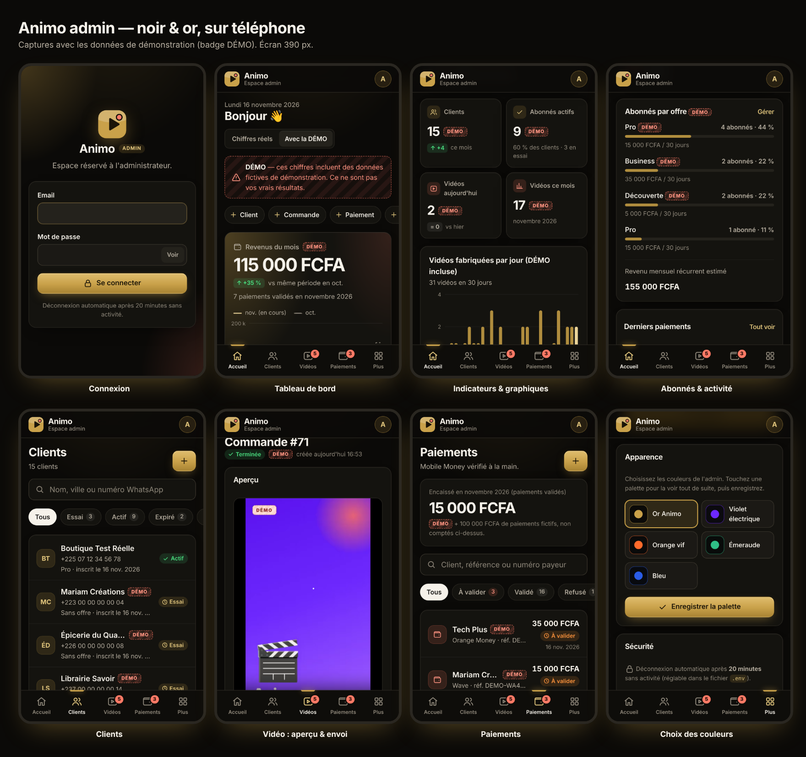
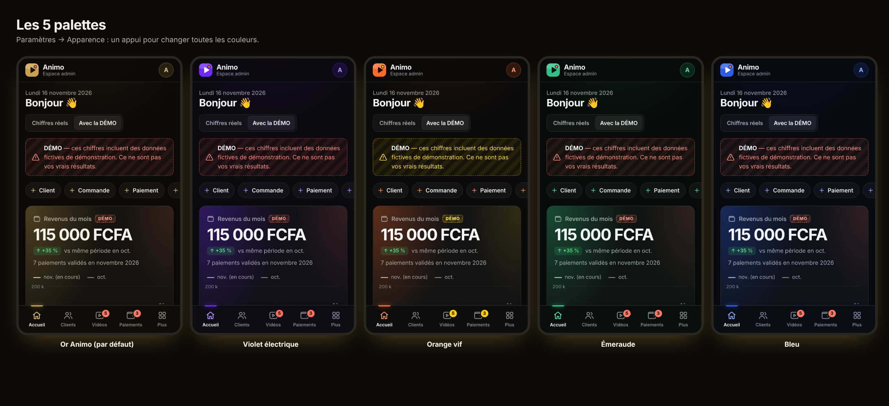

# Animo — espace administrateur

Admin du SaaS **Animo** (vidéos promo animées pour commerces et créateurs d'Afrique francophone).
Thème sombre (inspiration tableaux de bord SaaS type Whop), noir & or par défaut, 5 palettes au choix dans Paramètres → Apparence, police Inter.
Pensé d’abord pour le téléphone, puis l’ordinateur. Tout en français, montants en FCFA.





---

## 1. Ce qu'il faut

- **Node.js 22.13 ou plus récent** (version « LTS » conseillée) : <https://nodejs.org>
- Rien d'autre : la base de données (SQLite) est un simple fichier, intégré à Node.js.

Dépendances (installées par `npm install`) : `express` (serveur web), `ejs` (pages HTML),
`multer` (envoi de fichiers), `@fontsource-variable/inter` (police Inter, servie localement).

---

## 2. Lancer sur votre ordinateur

Dans un terminal, dans le dossier `animo-admin` :

```bash
npm install
```

```bash
cp .env.exemple .env
```

```bash
npm run creer-admin
```

(l'email et le mot de passe sont demandés ; mot de passe de 10 caractères minimum, masqué à la saisie)

```bash
npm start
```

Ouvrez **http://localhost:3000** et connectez-vous.

> Envie de voir l'app remplie tout de suite ? `npm run demo` ajoute des données fictives
> (toutes marquées **DÉMO**). `npm run demo:supprimer` les retire. Mêmes boutons dans **Paramètres**.

---

## 3. Tester sur votre téléphone

### A. Même Wi-Fi que l'ordinateur (le plus simple)

1. Lancez `npm start` sur l'ordinateur.
2. Le terminal affiche une ligne du type :
   `Sur votre téléphone (même Wi-Fi) : http://192.168.1.23:3000`
3. Tapez cette adresse dans Chrome ou Safari sur le téléphone.
4. Astuce : menu du navigateur → **« Ajouter à l'écran d'accueil »** : l'admin s'ouvre comme une appli.

Si la page ne s'ouvre pas : autorisez Node.js dans le pare-feu de l'ordinateur (Windows le demande au premier lancement).

En Wi-Fi local (adresse en `http://`), deux boutons sont limités par le navigateur : « Copier le lien »
affiche le lien au lieu de le copier, et « Partager le fichier » n'apparaît pas. Tout marche une fois en ligne en HTTPS.

### B. Directement sur un téléphone Android (sans ordinateur)

Avec l'appli **Termux** (à installer depuis F-Droid) :

```bash
pkg install nodejs-lts
```

Copiez le dossier `animo-admin` sur le téléphone (ZIP téléchargé depuis GitHub), puis dans ce dossier :

```bash
npm install && cp .env.exemple .env && npm run creer-admin
```

```bash
npm start
```

Ouvrez **http://localhost:3000** dans Chrome sur le même téléphone.

### C. Mettre en ligne (pour vos vrais clients)

- Hébergeur Node.js **avec disque persistant** (SQLite = un fichier) : Render avec un *Disk*,
  Railway avec un *Volume*, ou un petit VPS. Sans disque persistant, les données sont effacées
  à chaque redéploiement.
- Commande de démarrage : `npm start`.
- Variables à définir chez l'hébergeur (voir `.env.exemple`) :
  `DERRIERE_PROXY=oui`, `URL_PUBLIQUE=https://votre-adresse`, `DOSSIER_DONNEES=/chemin/du/disque`.
- Pas de terminal chez l'hébergeur ? Définissez aussi `ADMIN_EMAIL` et `ADMIN_MOT_DE_PASSE` :
  le compte est créé au premier démarrage. **Retirez ensuite le mot de passe.**
- Toujours en **HTTPS** (fourni automatiquement par ces hébergeurs).

---

## 4. Structure des fichiers

```
animo-admin/
├── server.js                 Point de départ : réglages, sécurité, branchement des pages
├── config.js                 Réglages techniques (.env) + listes modifiables (moyens de paiement…)
├── package.json              Dépendances et commandes (npm start, npm run demo…)
├── .env.exemple              Modèle de réglages à copier en .env
│
├── db/
│   ├── schema.sql            ★ Structure de la base (toutes les tables, commentées)
│   ├── database.js           Connexion SQLite + raccourcis (tous, un, executer…)
│   ├── demo.js               Données DÉMO : charger / supprimer
│   └── demo/                 Miniatures et petite vidéo de démonstration
│
├── lib/                      Outils partagés
│   ├── securite.js           Mots de passe, sessions, déconnexion auto, CSRF, anti force brute
│   ├── abonnements.js        Règles : activer, suspendre, prolonger, expiration, paiement validé
│   ├── format.js             FCFA « 25 000 FCFA », dates en français, numéros WhatsApp
│   ├── fichiers.js           Envoi de fichiers (preuves, miniatures, vidéos) + vérifications
│   ├── graphique.js          Données du graphique 30 jours
│   ├── outils.js             Paramètres de marque, journal, liens WhatsApp, pagination
│   └── vues.js               Menu, icônes, badges de statut, badge DÉMO
│
├── routes/                   Une page = un fichier
│   ├── auth.js               Connexion / déconnexion
│   ├── tableau.js            1. Tableau de bord
│   ├── clients.js            2. Clients
│   ├── commandes.js          3. Commandes de vidéos
│   ├── gabarits.js           4. Gabarits
│   ├── paiements.js          5. Paiements
│   ├── offres.js             6. Offres
│   ├── parametres.js         7. Paramètres
│   ├── fichiers.js           Fichiers privés (connexion obligatoire)
│   └── public.js             Page vidéo envoyée au client (/v/…)
│
├── views/                    Pages HTML (EJS)
│   ├── partials/             Haut, bas, menu, icônes, graphique, pagination…
│   ├── connexion.ejs  tableau.ejs  parametres.ejs  erreur.ejs  video-publique.ejs
│   ├── clients/       liste · fiche · formulaire
│   ├── commandes/     liste · fiche · formulaire
│   ├── gabarits/      liste · formulaire
│   ├── paiements/     liste · fiche · formulaire
│   └── offres/        liste · formulaire
│
├── public/
│   ├── css/style.css         ★ Tout le style (couleurs en haut du fichier)
│   ├── js/app.js             Déconnexion auto, confirmations, graphique, partage WhatsApp
│   ├── img/                  Logo et icônes d'écran d'accueil
│   └── manifest.webmanifest  « Ajouter à l'écran d'accueil »
│
├── scripts/
│   ├── creer-admin.js        npm run creer-admin
│   └── demo.js               npm run demo / demo:supprimer
│
└── donnees/                  (créé au lancement, jamais envoyé sur GitHub)
    ├── animo.db              La base de données
    └── fichiers/             preuves/ · miniatures/ · videos/
```

---

## 5. Base de données

Détail complet et commenté : [`db/schema.sql`](db/schema.sql). Les tables se créent seules au démarrage.

| Table | Contenu | Champs principaux |
|---|---|---|
| `admins` | Comptes administrateurs | email, mot_de_passe_hash (jamais en clair), derniere_connexion |
| `sessions` | Appareils connectés | empreinte du jeton, jeton CSRF, dernière activité |
| `tentatives_connexion` | Mots de passe faux (anti force brute) | ip, email, date |
| `offres` | Abonnements | nom, **prix_fcfa**, **videos_par_mois**, duree_jours, active |
| `clients` | Commerces et créateurs | nom, **whatsapp**, offre_id, **statut** (essai / actif / expire / suspendu), date_inscription, fin_abonnement |
| `gabarits` | Modèles de vidéos | nom, miniature, **duree_secondes**, format, **champs** (texte, logo, couleurs, photos, voix), actif |
| `commandes` | Vidéos commandées | client_id, gabarit_id, **statut** (en_attente / en_cours / terminee / echec), contenu, fichier_video, lien secret, envoye_le |
| `paiements` | Paiements FCFA | client_id, offre_id, **montant_fcfa**, moyen, référence, **preuve** (capture), statut (en_attente / valide / refuse) |
| `parametres` | Réglages de la marque | nom_marque, whatsapp_contact, message_video_prete… |
| `journal` | Qui a fait quoi | action, détails, date |

Conventions : montants en **nombres entiers FCFA** ; dates en texte `AAAA-MM-JJ HH:MM:SS` (fuseau du `.env`) ;
`est_demo = 1` pour les données de démonstration.

---

## 6. Les pages

| Page | Ce qu'on y fait | Code |
|---|---|---|
| **Connexion** | Email + mot de passe, admin uniquement | `routes/auth.js` · `views/connexion.ejs` |
| **1. Tableau de bord** | Clients, abonnés actifs, vidéos du jour / du mois, revenus du mois en FCFA, « À traiter », graphiques 30 jours | `routes/tableau.js` · `views/tableau.ejs` |
| **2. Clients** | Recherche (nom, ville, numéro), filtres par statut, fiche avec vidéos et paiements, **Activer / Suspendre / Prolonger** | `routes/clients.js` · `views/clients/` |
| **3. Vidéos** | Filtres (en attente, en cours, terminée, échec), aperçu, **Télécharger**, **Renvoyer au client** (WhatsApp), **Relancer le rendu**, joindre la vidéo finale | `routes/commandes.js` · `views/commandes/` |
| **4. Gabarits** | Ajouter, modifier, activer / désactiver ; nom, miniature, durée, champs client | `routes/gabarits.js` · `views/gabarits/` |
| **5. Paiements** | Liste FCFA, **Valider le paiement** avec capture de preuve, refuser | `routes/paiements.js` · `views/paiements/` |
| **6. Offres** | Créer / modifier : nom, prix FCFA, vidéos par mois, durée | `routes/offres.js` · `views/offres/` |
| **7. Paramètres** | Nom de marque, **palette de couleurs**, WhatsApp de contact, message automatique (avec aperçu), mot de passe, données DÉMO, journal | `routes/parametres.js` · `views/parametres.ejs` |

### Règles d'abonnement (`lib/abonnements.js`)

- Nouveau client → **essai** gratuit (durée réglable dans Paramètres, 3 jours par défaut).
- **Valider un paiement** lié à une offre → le client devient **actif** : nouvelle période dès aujourd'hui,
  ou ajoutée à la suite s'il est déjà actif.
- **Activer** → actif avec l'offre choisie (un client suspendu garde ses jours déjà payés).
- **Prolonger** → ajoute des jours à la date de fin.
- **Suspendre** → bloqué, les dates sont conservées.
- Date de fin dépassée → **expiré** automatiquement.

### Envoi au client sur WhatsApp

« Envoyer / Renvoyer au client » ouvre WhatsApp avec le message de Paramètres déjà écrit
(`{nom}`, `{lien}`, `{gabarit}`, `{marque}`, `{contact}`, `{numero}`). Le `{lien}` mène à une page
publique sécurisée (`/v/…`) où le client regarde et télécharge **sa** vidéo. Sur téléphone, « Partager le fichier »
envoie directement le MP4.

---

## 7. Sécurité

- Mots de passe hachés (scrypt), jamais stockés en clair.
- **Déconnexion automatique** après 20 minutes sans activité (réglable : `DECONNEXION_APRES_MINUTES`),
  avec alerte « Rester connecté » 60 secondes avant ; session de 12 h maximum.
- Blocage 15 minutes après 5 mots de passe faux.
- Jeton anti-CSRF sur chaque formulaire, cookie `HttpOnly` + `SameSite`, `Secure` en HTTPS.
- En-têtes de sécurité (CSP, anti-iframe…), pages admin jamais mises en cache.
- Fichiers privés (preuves, vidéos) visibles seulement une fois connecté ; contenu vérifié
  (une « image » doit vraiment être une image).
- Changer le mot de passe déconnecte les autres appareils ; journal de toutes les actions.

---

## 8. Données DÉMO (jamais de faux chiffres présentés comme vrais)

- Aucune donnée n'est créée sans votre accord : l'app démarre **vide**.
- Les données DÉMO (3 offres, 5 gabarits, 14 clients, 36 vidéos, 19 paiements) portent un **badge rayé « DÉMO »** partout,
  et des numéros factices (+225 00 00 00 00 xx).
- Le tableau de bord affiche par défaut les **chiffres réels** seulement ; le bouton « Avec la DÉMO »
  les ajoute, avec un bandeau d'avertissement.
- Suppression en un clic (Paramètres) : vos vraies données ne sont pas touchées.

---

## 9. Modifier facilement

| Je veux changer… | Où |
|---|---|
| Les couleurs | Page **Paramètres → Apparence** (5 palettes). Pour créer la vôtre : `public/css/style.css` (blocs `data-palette`) + `config.js` → `palettes` |
| La liste des moyens de paiement | `config.js` → `moyensPaiement` |
| Les types de champs des gabarits / formats | `config.js` → `typesChamps`, `formats` |
| La durée avant déconnexion | `.env` → `DECONNEXION_APRES_MINUTES` |
| Le fuseau horaire | `.env` → `FUSEAU_HORAIRE` |
| Le message WhatsApp, la marque, l'essai gratuit | Page **Paramètres** (sans toucher au code) |
| Ajouter une colonne à une table | `db/schema.sql` + la page concernée (voir l'encadré ci-dessous) |

> **Ajouter une colonne plus tard** : `CREATE TABLE IF NOT EXISTS` ne modifie pas une table déjà créée.
> Ajoutez la colonne dans `schema.sql` (pour les nouvelles installations) **et** lancez une fois
> `ALTER TABLE clients ADD COLUMN email TEXT;` sur votre base existante.

**Sauvegarde** : copiez régulièrement le dossier `donnees/` (base + fichiers). C'est tout.

---

## 10. Ce qui n'est pas encore automatique (prochaines étapes)

Ce code est l'**admin**. Trois briques viendront ensuite ; leur place est déjà prévue :

1. **Moteur de rendu** : il prendra les commandes « en attente » et déposera la vidéo finale.
   En attendant, fabriquez la vidéo vous-même et joignez-la (bouton « Enregistrer la vidéo »).
   « Relancer le rendu » remet la commande dans cette file.
2. **Envoi WhatsApp 100 % automatique** : nécessite l'API WhatsApp Business (Meta).
   Aujourd'hui, un appui ouvre WhatsApp avec le message prêt à envoyer.
3. **Paiement Mobile Money automatique** : via un agrégateur de paiement.
   Aujourd'hui, la validation se fait à la main avec la capture de preuve, comme demandé.
